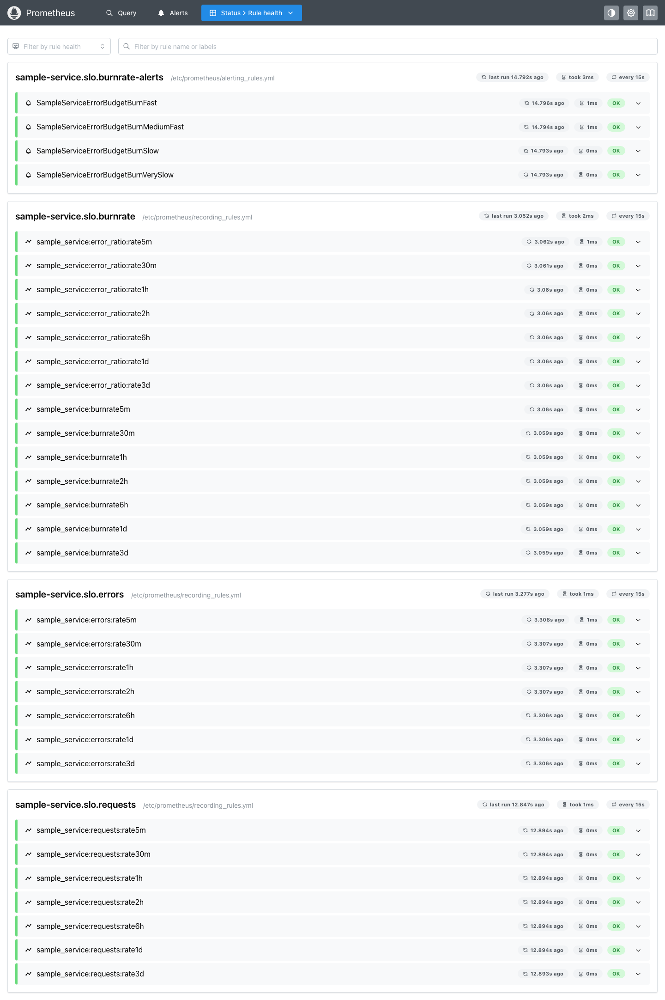
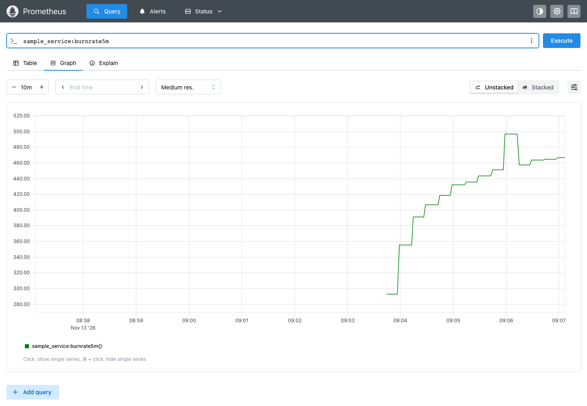
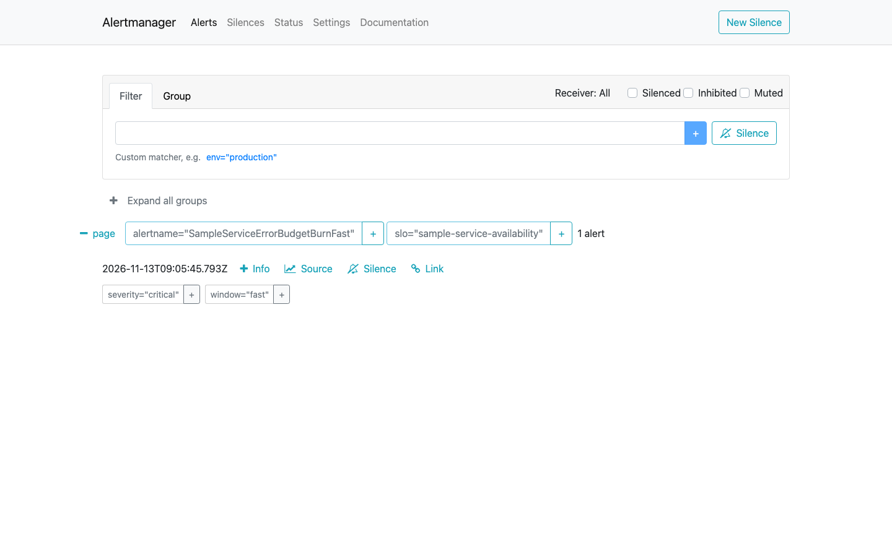
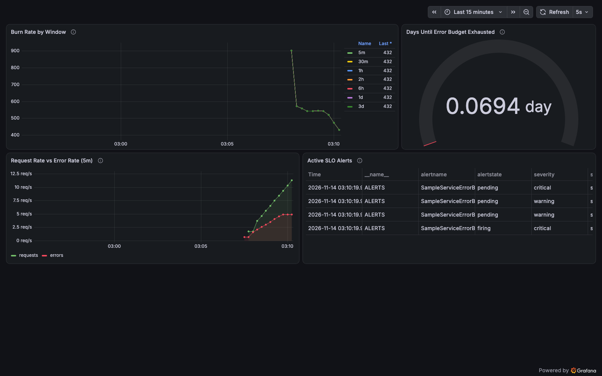
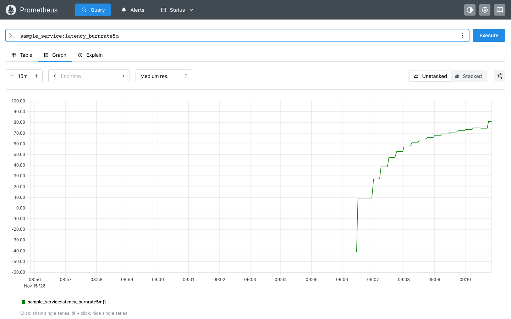
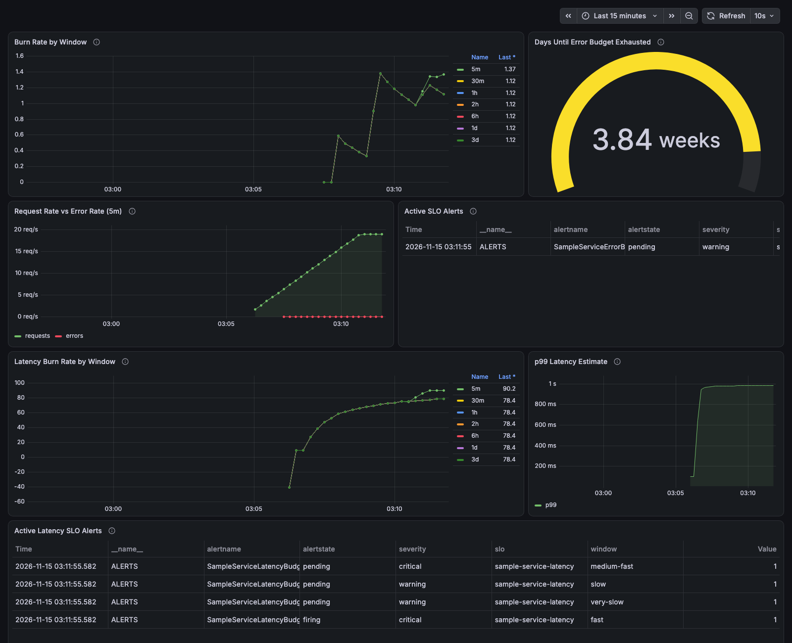
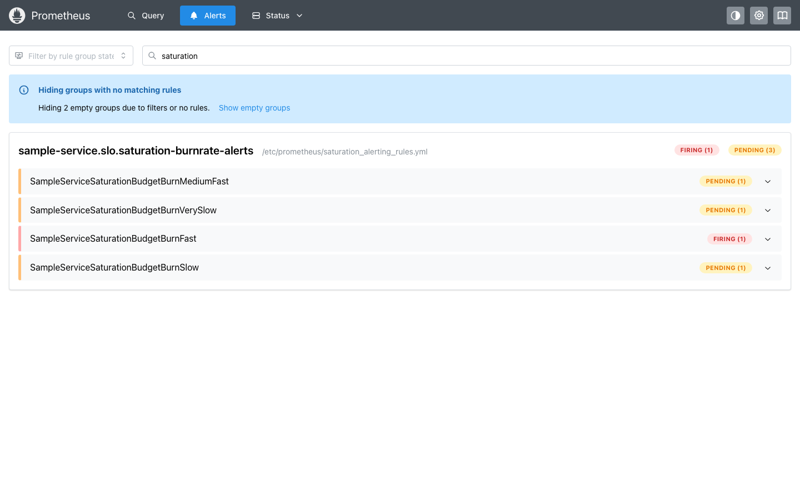
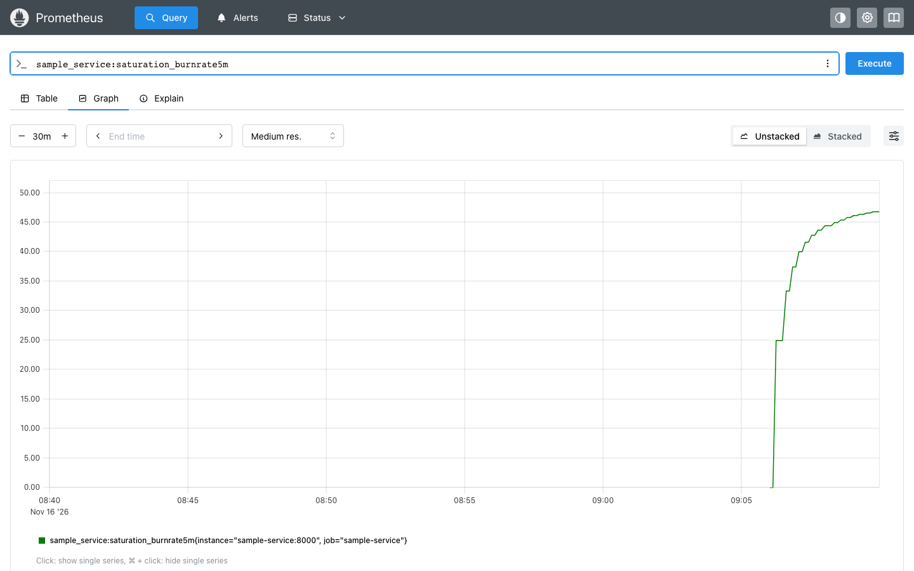
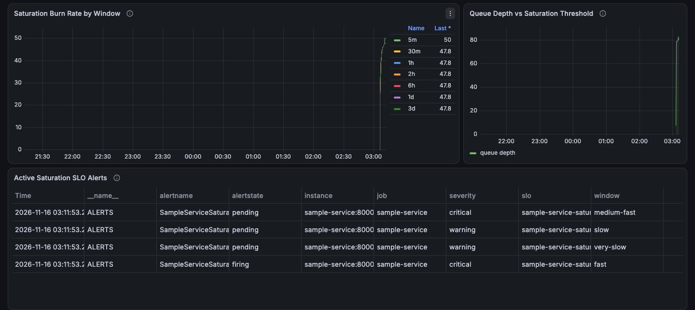
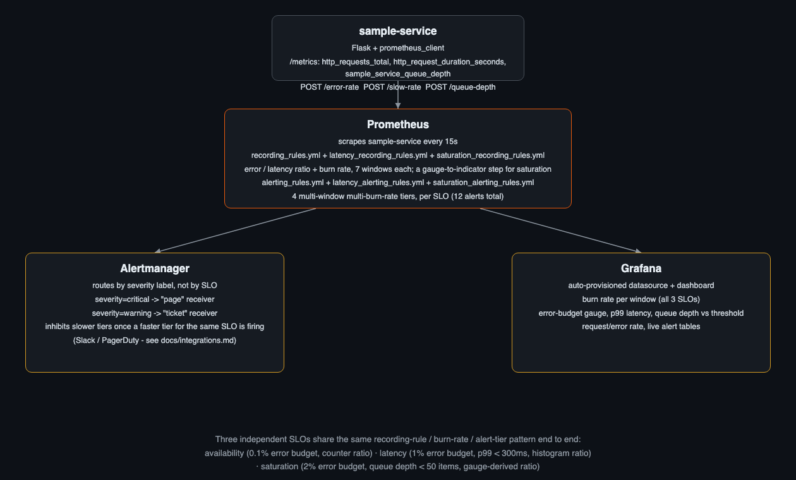

# slo-burn-rate-alerts


A reference implementation of Google SRE-style **multi-window,
multi-burn-rate** alerting for error-budget SLOs: Prometheus recording
rules, three independent SLOs (availability, latency, and saturation)
each with their own 4-tier Alertmanager routing setup, and a runbook that
explains the math and the false-positive/false-negative tradeoffs behind
the thresholds.

Most "SLO alerting" examples online are a single PromQL expression and a
`for: 5m`. That's either too slow to catch real incidents or too noisy to
trust. This repo implements the full method from the [Google SRE
Workbook](https://sre.google/workbook/alerting-on-slos/): four alert tiers,
each requiring agreement between a short window and a long window, so fast
severe incidents page in minutes while slow chronic degradation files a
ticket instead of waking anyone up.

## Quick start

Requires Docker and Docker Compose.

```bash
git clone https://github.com/tenalisriharsha/slo-burn-rate-alerts.git
cd slo-burn-rate-alerts
make up
```

This builds and starts four containers:

- **sample-service** (`localhost:8000`) - a Flask app that exposes
  `/metrics` and continuously generates synthetic HTTP traffic at a
  configurable error rate, slow-request rate, and queue depth
- **Prometheus** (`localhost:9090`) - scrapes the sample service and
  evaluates the recording/alerting rules in [`prometheus/`](prometheus)
- **Alertmanager** (`localhost:9093`) - receives alerts and routes them by
  severity, per [`alertmanager/alertmanager.yml`](alertmanager/alertmanager.yml)
- **Grafana** (`localhost:3000`) - a provisioned dashboard visualizing burn
  rate per window, an error-budget gauge, request/error rate, and live
  alert state (anonymous viewer access is enabled, so no login is needed;
  admin/admin if you do want to sign in)

Simulate an incident and watch the alerts move from `inactive` to `pending`
to `firing` as the burn rate crosses each tier's threshold:

```bash
make burn RATE=0.5    # push the sample service's error rate to 50%
# watch http://localhost:9090/alerts and http://localhost:3000
make reset            # back to the healthy baseline (0.1% errors)
```

The same works for the latency SLO (p99 < 300ms) via `POST /slow-rate`,
which controls the fraction of synthetic requests that take 350-600ms
instead of 10-80ms:

```bash
curl -X POST localhost:8000/slow-rate -H 'Content-Type: application/json' -d '{"rate": 0.9}'
# watch the latency burn-rate alerts move the same way the availability ones do
curl -X POST localhost:8000/slow-rate -H 'Content-Type: application/json' -d '{"rate": 0.001}'
```

And again for the saturation SLO (queue depth under 50 items 98% of the
time) via `POST /queue-depth`, which sets the target depth the synthetic
work queue jitters around:

```bash
curl -X POST localhost:8000/queue-depth -H 'Content-Type: application/json' -d '{"target": 80}'
# watch the saturation burn-rate alerts move the same way, built from a gauge instead of a counter
curl -X POST localhost:8000/queue-depth -H 'Content-Type: application/json' -d '{"target": 5}'
```

Or run the same thing as a scripted, self-recovering incident:

```bash
make demo             # ramps error rate to 50%, holds 150s, then auto-recovers
```

`scripts/demo-incident.sh` also supports the other 3 tiers
(`make demo TIER=medium-fast`, `slow`, `very-slow`), though their `for`
durations (15m/1h/3h) make them impractical to sit and watch - they're
there for completeness. See the script's header comment for details.

Validate the Prometheus/Alertmanager configs on their own (no containers to
keep running) with:

```bash
make check
```

Lint the sample service (requires `pip install -r sample-service/requirements-dev.txt`):

```bash
make lint
```

## Preview

The sample service's error rate was pushed to 50% to simulate an incident,
and the stack below is the result - real Prometheus, Alertmanager, and
Grafana UIs, not mockups.

**Sample service health endpoint**, showing the elevated error rate during
the simulated incident:


**Prometheus rules page**, showing the recording rules and the 4-tier
alerting rules loaded and evaluating:



**Prometheus alerts page**, with the fast-burn tier firing and the other
three tiers pending, during the simulated incident:


**Prometheus graph** of `sample_service:burnrate5m` spiking well past the
14.4x fast-burn threshold:



**Alertmanager UI**, showing the same alerts routed and grouped by
severity:



**Grafana dashboard**, captured 15 minutes into the same simulated
incident: the burn-rate spike across all 7 windows, the error-budget gauge
dropping to a fraction of a day remaining, the request/error rate split,
and the live alert table:



For the independent **latency SLO** (p99 < 300ms), the sample service's
`/slow-rate` was pushed to 90% instead:

**Prometheus alerts page**, filtered to the latency tiers, with the
fast-burn tier firing and the other three pending:


**Prometheus graph** of `sample_service:latency_burnrate5m` climbing from
baseline noise to ~90x, well past the 14.4x fast-burn threshold:



**Grafana dashboard**, scrolled down to the latency panels: burn rate per
window, the p99 latency estimate crossing the 300ms SLO line, and the live
latency alert table showing all 4 tiers:



For the independent **saturation SLO** (queue depth < 50 items), the
sample service's `/queue-depth` target was pushed to 80 instead:

**Prometheus alerts page**, filtered to the saturation tiers, with the
fast-burn tier firing and the other three pending:



**Prometheus graph** of `sample_service:saturation_burnrate5m` climbing
from baseline noise to ~50x, well past the 14.4x fast-burn threshold:



**Grafana dashboard**, scrolled down to the saturation panels: burn rate
per window, the queue depth crossing the 50-item saturation threshold, and
the live saturation alert table showing all 4 tiers:



## How it works



```
sample-service (Flask + prometheus_client)
    - exposes /metrics (http_requests_total{code}, http_request_duration_seconds,
      sample_service_queue_depth)
    - POST /error-rate, POST /slow-rate, POST /queue-depth let you simulate an incident
        |
        v
Prometheus
    - scrapes sample-service
    - recording_rules.yml + latency_recording_rules.yml + saturation_recording_rules.yml:
      error ratio / latency ratio / saturation ratio + burn rate, each over 7 windows
      (5m, 30m, 1h, 2h, 6h, 1d, 3d)
    - alerting_rules.yml + latency_alerting_rules.yml + saturation_alerting_rules.yml:
      4 multi-window multi-burn-rate tiers per SLO (12 alerts total)
        |              \
        v               v
Alertmanager          Grafana
    - routes severity=critical       - provisioned dashboard: burn rate
      -> "page" receiver               per window (all 3 SLOs), error-budget
    - routes severity=warning           gauge, p99 latency, queue depth vs
      -> "ticket" receiver               threshold, request/error rate,
    - inhibits slower tiers once a      live alert tables
      faster tier is already firing
      (per SLO)
```

Three independent SLOs are modeled, each using the exact same burn-rate
method and the exact same four thresholds - only the budget constant (and,
for saturation, the underlying metric shape) differs:

**Availability** - 99.9% of requests succeed over a rolling 30-day window
(0.1% error budget):

| Alert | Long window | Short window | Burn rate threshold | `for` | Severity |
|---|---|---|---|---|---|
| `SampleServiceErrorBudgetBurnFast` | 1h | 5m | 14.4x | 2m | critical (page) |
| `SampleServiceErrorBudgetBurnMediumFast` | 6h | 30m | 6x | 15m | critical (page) |
| `SampleServiceErrorBudgetBurnSlow` | 1d | 2h | 3x | 1h | warning (ticket) |
| `SampleServiceErrorBudgetBurnVerySlow` | 3d | 6h | 1x | 3h | warning (ticket) |

**Latency** - 99% of requests complete in under 300ms over a rolling
30-day window (1% error budget):

| Alert | Long window | Short window | Burn rate threshold | `for` | Severity |
|---|---|---|---|---|---|
| `SampleServiceLatencyBudgetBurnFast` | 1h | 5m | 14.4x | 2m | critical (page) |
| `SampleServiceLatencyBudgetBurnMediumFast` | 6h | 30m | 6x | 15m | critical (page) |
| `SampleServiceLatencyBudgetBurnSlow` | 1d | 2h | 3x | 1h | warning (ticket) |
| `SampleServiceLatencyBudgetBurnVerySlow` | 3d | 6h | 1x | 3h | warning (ticket) |

**Saturation** - queue depth stays under 50 items at least 98% of the time
over a rolling 30-day window (2% error budget):

| Alert | Long window | Short window | Burn rate threshold | `for` | Severity |
|---|---|---|---|---|---|
| `SampleServiceSaturationBudgetBurnFast` | 1h | 5m | 14.4x | 2m | critical (page) |
| `SampleServiceSaturationBudgetBurnMediumFast` | 6h | 30m | 6x | 15m | critical (page) |
| `SampleServiceSaturationBudgetBurnSlow` | 1d | 2h | 3x | 1h | warning (ticket) |
| `SampleServiceSaturationBudgetBurnVerySlow` | 3d | 6h | 1x | 3h | warning (ticket) |

Unlike availability and latency, saturation isn't a good/bad event ratio -
it's measured on a gauge (`sample_service_queue_depth`), so a recording
rule first turns it into a `1`/`0` over-threshold indicator before the
same `avg_over_time()` + burn-rate math applies unchanged. See
[`docs/runbook.md`](docs/runbook.md#saturation-slo) for how that
adaptation works and what it costs.

Full explanation of where these numbers come from, why both a short and a
long window are required, how the latency and saturation SLOs reuse the
identical math, and the precision/detection-speed tradeoff behind each
tier is in [`docs/runbook.md`](docs/runbook.md).

## Repository layout

```
prometheus/
  prometheus.yml                  scrape config, rule files + Alertmanager wiring
  recording_rules.yml             error ratio + burn rate per window (availability)
  alerting_rules.yml              4-tier multi-window multi-burn-rate alerts (availability)
  latency_recording_rules.yml     latency ratio + burn rate per window (latency SLO)
  latency_alerting_rules.yml      4-tier multi-window multi-burn-rate alerts (latency SLO)
  saturation_recording_rules.yml  gauge-to-indicator + ratio + burn rate per window (saturation SLO)
  saturation_alerting_rules.yml   4-tier multi-window multi-burn-rate alerts (saturation SLO)
alertmanager/
  alertmanager.yml       severity-based routing + inhibition rules
  (Slack/PagerDuty receiver blocks - see docs/integrations.md to activate)
grafana/
  provisioning/          auto-wired Prometheus datasource + dashboard provider
  dashboards/            the SLO burn-rate dashboard JSON (all 3 SLOs)
sample-service/
  app.py                 Flask app: /metrics, /error-rate, /slow-rate, /queue-depth, synthetic traffic
scripts/
  demo-incident.sh       scripted ramp/hold/recover incident for any of the
                          4 availability alert tiers
docs/
  runbook.md             the math and the tradeoffs, for all 3 SLOs
  integrations.md        wiring up real Slack/PagerDuty delivery
docker-compose.yml       wires all four services together
Makefile                 up / down / check / lint / burn / reset / demo
```

## Status

Core foundation (recording rules, 4-tier alerting rules, Alertmanager
routing, the demo stack, and the runbook), the Grafana dashboard and
scripted incident demo, real Slack/PagerDuty integration instructions, and
two additional independent SLOs (latency, p99 < 300ms; saturation, queue
depth < 50 items) reusing the identical burn-rate method are complete and
tested end-to-end against a real running stack. See
[PROGRESS.md](PROGRESS.md) for the full phase-by-phase history and what's
planned next.

## License

MIT - see [LICENSE](LICENSE).
