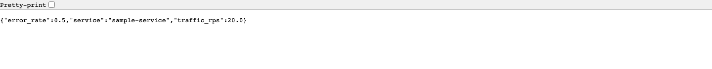
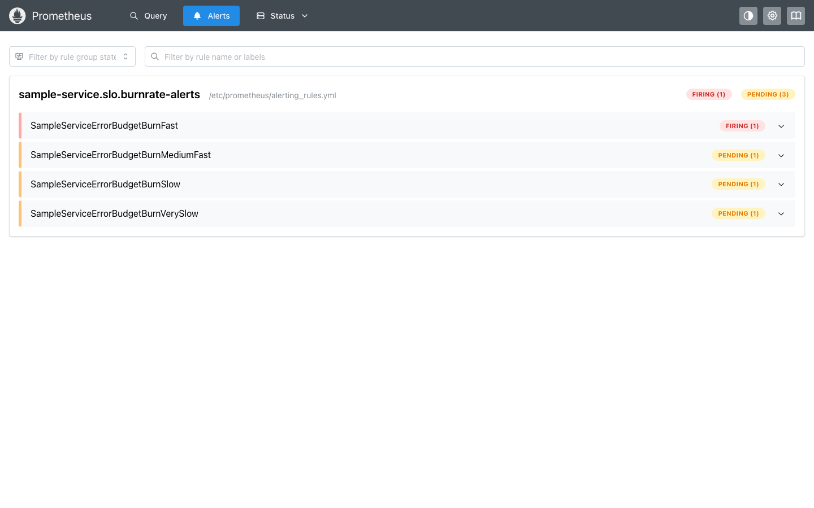

# slo-burn-rate-alerts


A reference implementation of Google SRE-style **multi-window,
multi-burn-rate** alerting for error-budget SLOs: Prometheus recording
rules, a 4-tier Alertmanager routing setup, and a runbook that explains the
math and the false-positive/false-negative tradeoffs behind the thresholds.

Most "SLO alerting" examples online are a single PromQL expression and a
`for: 5m`. That's either too slow to catch real incidents or too noisy to
trust. This repo implements the full method from the [Google SRE
Workbook](https://sre.google/workbook/alerting-on-slos/): four alert tiers,
each requiring agreement between a short window and a long window, so fast
severe incidents page in minutes while slow chronic degradation files a
ticket instead of waking anyone up.

## Quick start

Requires Docker and Docker Compose.

```bash
git clone https://github.com/tenalisriharsha/slo-burn-rate-alerts.git
cd slo-burn-rate-alerts
make up
```

This builds and starts three containers:

- **sample-service** (`localhost:8000`) - a Flask app that exposes
  `/metrics` and continuously generates synthetic HTTP traffic at a
  configurable error rate
- **Prometheus** (`localhost:9090`) - scrapes the sample service and
  evaluates the recording/alerting rules in [`prometheus/`](prometheus)
- **Alertmanager** (`localhost:9093`) - receives alerts and routes them by
  severity, per [`alertmanager/alertmanager.yml`](alertmanager/alertmanager.yml)

Simulate an incident and watch the alerts move from `inactive` to `pending`
to `firing` as the burn rate crosses each tier's threshold:

```bash
make burn RATE=0.5    # push the sample service's error rate to 50%
# watch http://localhost:9090/alerts
make reset            # back to the healthy baseline (0.1% errors)
```

Validate the Prometheus/Alertmanager configs on their own (no containers to
keep running) with:

```bash
make check
```

## Preview

The sample service's error rate was pushed to 50% to simulate an incident,
and the stack below is the result - real Prometheus and Alertmanager UIs,
not mockups.

**Sample service health endpoint**, showing the elevated error rate during
the simulated incident:



**Prometheus rules page**, showing the recording rules and the 4-tier
alerting rules loaded and evaluating:


**Prometheus alerts page**, with the fast-burn tier firing and the other
three tiers pending, during the simulated incident:



**Prometheus graph** of `sample_service:burnrate5m` spiking well past the
14.4x fast-burn threshold:


**Alertmanager UI**, showing the same alerts routed and grouped by
severity:


## How it works

```
sample-service (Flask + prometheus_client)
    - exposes /metrics (http_requests_total{code})
    - POST /error-rate lets you simulate an incident
        |
        v
Prometheus
    - scrapes sample-service
    - recording_rules.yml: error ratio + burn rate over 7 windows
      (5m, 30m, 1h, 2h, 6h, 1d, 3d)
    - alerting_rules.yml: 4 multi-window multi-burn-rate alert tiers
        |
        v
Alertmanager
    - routes severity=critical -> "page" receiver
    - routes severity=warning  -> "ticket" receiver
    - inhibits slower tiers once a faster tier is already firing
```

The SLO modeled here is 99.9% availability over a rolling 30-day window
(0.1% error budget). The four alert tiers:

| Alert | Long window | Short window | Burn rate threshold | `for` | Severity |
|---|---|---|---|---|---|
| `SampleServiceErrorBudgetBurnFast` | 1h | 5m | 14.4x | 2m | critical (page) |
| `SampleServiceErrorBudgetBurnMediumFast` | 6h | 30m | 6x | 15m | critical (page) |
| `SampleServiceErrorBudgetBurnSlow` | 1d | 2h | 3x | 1h | warning (ticket) |
| `SampleServiceErrorBudgetBurnVerySlow` | 3d | 6h | 1x | 3h | warning (ticket) |

Full explanation of where these numbers come from, why both a short and a
long window are required, and the precision/detection-speed tradeoff behind
each tier is in [`docs/runbook.md`](docs/runbook.md).

## Repository layout

```
prometheus/
  prometheus.yml        scrape config, rule file + Alertmanager wiring
  recording_rules.yml   error ratio + burn rate per window
  alerting_rules.yml    the 4-tier multi-window multi-burn-rate alerts
alertmanager/
  alertmanager.yml       severity-based routing + inhibition rules
sample-service/
  app.py                 Flask app: /metrics, /error-rate, synthetic traffic
docs/
  runbook.md             the math and the tradeoffs
docker-compose.yml       wires all three services together
Makefile                 up / down / check / burn / reset
```

## Status

Phase 1 (core foundation: recording rules, 4-tier alerting rules,
Alertmanager routing, the demo stack, and the runbook) is complete and
tested end-to-end against a real running stack. See
[PROGRESS.md](PROGRESS.md) for the full phase-by-phase history and what's
planned next (a Grafana dashboard and a scripted incident demo).

## License

MIT - see [LICENSE](LICENSE).
